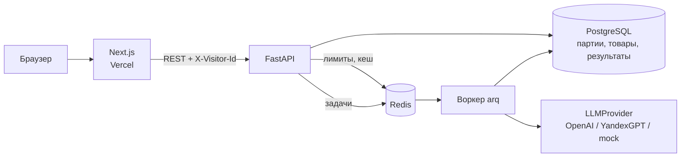

# CardForge — генератор карточек товаров для Ozon и Wildberries

<p align="center">
  
</p>

Сервис превращает таблицу с сырыми данными о товарах в готовые карточки для маркетплейсов: название, описание, нормализованные характеристики и ключевые слова. Каждая карточка проходит автоматическую проверку: лимиты маркетплейса, запрещённые формулировки и «выдумки» — числа и материалы, которых не было в исходных данных.

**Для кого:** селлеры и менеджеры интернет-магазинов, у которых сотни SKU и нет времени писать карточки руками.

**Демо-легенда:** магазин товаров для дома «Уютный угол», 30 товаров уже загружено и обработано.

## 🚀 Демо

- Демо: **https://cardforge-weld.vercel.app**
- API: https://cardforge-api.vercel.app/docs
- Регистрация не нужна: при первом входе у вас своя копия демо-партии, которую можно править и сбрасывать.
- `/` — лендинг, `/app` — рабочее пространство, `/app/demo` — сразу открывает демо-партию.

### Попробовать на своей таблице

В папке [`examples/`](examples) лежит тестовая партия другого магазина — спорттовары, 12 строк в CSV и XLSX. Названия колонок отличаются от демо («Код товара», «Наименование товара», «Производитель», «Свойства»), есть лишние колонки, строка без фото и строка без названия. Загрузите файл в «Новая партия» и посмотрите, как сервис сопоставит колонки и что скажут проверки.

## Что умеет

**Сценарий:** загрузить CSV/XLSX → сопоставить колонки → выбрать маркетплейс, тон и длину → смотреть прогресс по строкам → поправить карточку → скачать XLSX.

- **Загрузка CSV и XLSX** — разделитель `,` `;` или табуляция, кодировки UTF-8 и Windows-1251. Колонки угадываются по названиям («Наименование», «Производитель», «Предмет»…), сопоставление можно поправить вручную. Лишние колонки по желанию становятся характеристиками.
- **Настройки генерации** — Ozon (название до 200 символов) или Wildberries (до 60), тон: нейтральный / продающий / премиум, длина описания: 500–900 / 900–1400 / 1400–2000 символов.
- **Фоновая очередь** — каждая строка обрабатывается отдельной задачей arq + Redis, статусы `в очереди / в работе / готово / ошибка`, прогресс обновляется раз в 2 секунды, упавшие строки перезапускаются одной кнопкой.
- **Редактор карточки «было → стало»** — исходные данные слева, результат справа. Любое поле можно поправить руками или попросить ИИ переписать с комментарием («короче», «больше про материал»). Счётчики символов подсвечивают превышение лимитов, а выдуманные и запрещённые фрагменты подсвечиваются прямо в тексте.
- **Превью «как увидит покупатель»** — упрощённый макет витрины с фото, характеристиками и описанием.
- **Проверки** — для каждой карточки:
  - длина названия, описания и число ключевых слов;
  - запрещённые формулировки («лучший», «№1», «хит продаж»…);
  - подозрение на выдумку: числа и материалы в тексте сверяются с исходником;
  - нехватка исходных данных (нет бренда, мало характеристик).
- **Экспорт в XLSX** — колонки под шаблон выбранного маркетплейса, характеристики — отдельными колонками, на втором листе все предупреждения.
- **История загрузок** — прошлые партии, повторное скачивание.

## Как устроена работа с нейросетью

```
Строка таблицы ─► промпт с правилами маркетплейса ─► LLMProvider ─► JSON по схеме
                                                                       │
                       Pydantic-валидация ◄────────────────────────────┘
                              │
                     проверки карточки ── нарушения? ──► один повторный запрос с перечнем ошибок
                              │
                     карточка + предупреждения ─► PostgreSQL
```

- **Слой `LLMProvider`** (`backend/app/llm/`) — провайдер выбирается переменной `LLM_PROVIDER`:
  - `openai` — любой OpenAI-совместимый API: OpenAI, OpenRouter, DeepSeek, vLLM, Ollama. Ответ запрашивается через `response_format: json_schema` в строгом режиме;
  - `yandex` — YandexGPT через Foundation Models API с `jsonSchema`: данные не уходят за рубеж;
  - `mock` — шаблонный генератор без внешнего API, чтобы проект запускался без ключей.
- Ответ модели всегда валидируется Pydantic-схемой. Если JSON битый или карточка нарушает правила, модель получает один повторный запрос с перечнем ошибок, а из попыток выбирается лучшая.
- Модели нельзя доверять на слово, что она ничего не выдумала, поэтому проверка «выдумок» — отдельный детерминированный код (`backend/app/services/checks.py`), а не просьба в промпте. Тест `test_demo_cards_have_no_fabrications` гоняет её на всех 30 демо-карточках.

## SEO

- Лендинг отрисовывается на сервере: метаданные, canonical, Open Graph и Twitter-карточка, JSON-LD `SoftwareApplication`.
- OG-картинка генерируется кодом (`app/opengraph-image.tsx`) со шрифтом Onest, иконки — `icon.svg` и `apple-icon`.
- `robots.txt`, `sitemap.xml`, `manifest.webmanifest`. Рабочее пространство `/app` персональное, поэтому закрыто от индексации.

## Защита бюджета публичного демо

| Мера | Значение по умолчанию |
| --- | --- |
| Строк в файле | не больше 50 |
| Размер файла | до 2 МБ, ячейка до 1000 символов |
| Партий с одного IP | 3 в час (перезапуск упавших строк считается партией) |
| Генераций с одного IP | 20 в час (перегенерация поля или карточки) |
| Кеш | одинаковые запросы к модели берутся из Redis 7 дней |
| Очистка | партии старше 24 часов удаляются ночной задачей, демо пересоздаётся при следующем визите |
| Сброс | кнопка «Сбросить демо» возвращает партию «Уютного угла» в исходное состояние |

Демо-партия хранится в репозитории уже сгенерированной (`backend/app/seed/`), поэтому первый визит не тратит токены. В двух карточках специально оставлены типичные ошибки модели — «лучше» в описании сковороды и выдуманный размер кровати у одеяла, — чтобы было видно, как работает подсветка.

## Архитектура



- Регистрации нет: фронтенд создаёт анонимный `visitor_id` в `localStorage`, у каждого посетителя свои партии и своя копия демо.
- API и воркер собираются из одного образа, воркер запускается командой `arq app.worker.WorkerSettings`.
- Демо развёрнуто на Vercel, где нет постоянного процесса для воркера. Там включается режим `QUEUE_MODE=poll`: каждый опрос партии фронтендом обрабатывает следующие 5 строк, строки захватываются через `SELECT … FOR UPDATE SKIP LOCKED`, а брошенные возвращаются в очередь.

## Стек

| Часть | Технологии |
| --- | --- |
| Фронтенд | Next.js 16 (App Router, Cache Components), TypeScript, Tailwind CSS 4, SWR, lucide-react |
| Бэкенд | Python 3.12, FastAPI, SQLAlchemy 2 (async), Pydantic 2, httpx |
| Очередь | arq + Redis (Docker, VPS) или обработка по опросу (Vercel) |
| Данные | PostgreSQL 16 (в демо — Neon), Redis (в демо — Upstash) |
| Файлы | openpyxl, csv |
| Тесты | pytest, fakeredis, SQLite в тестах |

## Запуск локально

Нужен Docker.

```bash
cp .env.example .env
docker compose up --build
```

- Фронтенд: http://localhost:3000
- API и Swagger: http://localhost:8000/docs

По умолчанию `LLM_PROVIDER=mock` — всё работает без ключей. Чтобы подключить настоящую модель, укажите в `.env`, например:

```env
LLM_PROVIDER=openai
OPENAI_API_KEY=sk-...
OPENAI_MODEL=gpt-5.6-luna
OPENAI_REASONING_EFFORT=none
```

`OPENAI_REASONING_EFFORT` нужен только моделям GPT-5 и o-серии. Если модель не принимает температуру или глубину рассуждений, сервис один раз повторит запрос без этого параметра.

### Без Docker (для разработки)

```bash
docker compose up -d postgres redis

cd backend
uv sync
uv run uvicorn app.main:app --reload       # API
uv run arq app.worker.WorkerSettings        # воркер, в отдельном терминале

cd frontend
cp .env.example .env.local
npm install
npm run dev
```

### Тесты

```bash
cd backend
uv run pytest
uv run ruff check app tests
```

---

Демо-проект: магазин «Уютный угол», бренды и товары вымышлены. Фото товаров используются только для демонстрации.
